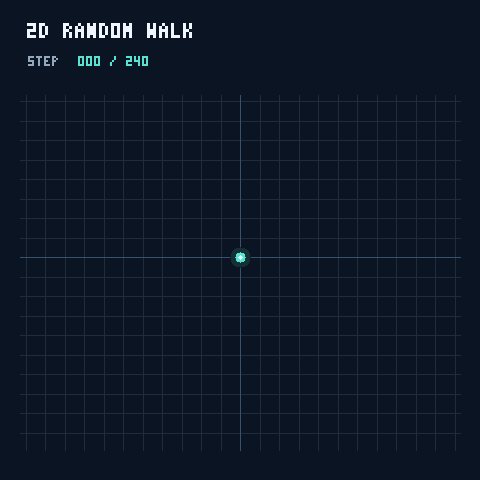

# 二维与三维随机游走

来源聊天：codex://threads/01a1299c-c495-7be0-b8c4-9ed5d84162ed

导出日期：2026-10-14（Asia/Shanghai）。保留用户与助手对话；省略系统环境、开发者指令、内部推理和工具日志。本地成品链接已改为仓库相对路径。

## 1. 用户

制作一个动画来展示二维随机游走

## 2. 助手

我会制作一个可交互的二维随机游走动画，展示粒子的运动轨迹，并提供暂停、重置和速度调节。

## 3. 助手

交互动画已完成：粒子每步等概率选择四个方向，并实时显示步数、坐标和距原点的距离。我正在补充可直接预览的动图，并检查控制按钮的行为。

## 4. 助手

已制作完成。每一步以 25% 的概率选择上、下、左、右。

[打开交互版动画](../random-walk/random-walk.html)，支持暂停、单步前进、重置和调速，并实时显示坐标与位移。

## 5. 用户

再加上三维随机游走，不用制作步数限制，一进程序就一直运行，直至程序关闭

## 6. 助手

我会在现有动画中加入三维随机游走，并移除步数上限。程序打开后会自动持续运行，直到关闭页面。

## 7. 助手

二维和三维会并排持续运行，三维视图支持拖动旋转和滚轮缩放。为避免长时间运行占用越来越多内存，画面会保留最近 10,000 步的轨迹，累计步数和实际位置则一直更新。

## 8. 助手

已检查两个维度连续运行 43,200 步的情况：都没有自动停止，轨迹缓冲区占用保持固定。正在核对页面显示和三维视角操作。

## 9. 助手

[打开更新后的动画](../random-walk/random-walk.html)

二维与三维同时自动运行，无步数上限，关闭页面才结束。三维支持旋转和缩放，速度可调。

为保证长期流畅，显示最近 10,000 步轨迹，累计步数和位置持续更新。

## 10. 用户

动画要求网页全屏，累计步数和位置，调节速度等按钮放在网站右下角，其余一律删除，除此将二维和三维分开，设计一个按钮一键切换，二维支持缩放，三维支持旋转和缩放

## 11. 助手

我会将动画改为铺满整个网页，只保留右下角的步数、位置、速度调节和二维／三维切换控件；二维支持缩放，三维支持旋转与缩放。

## 12. 助手

已改成单个全屏画布，右下角只保留步数、位置、速度、切换和缩放控件。切换维度会保留各自的轨迹与缩放状态；二维和三维都支持滚轮、按钮及双指缩放，三维可拖动旋转。

## 13. 助手

[打开更新后的动画](../random-walk/random-walk.html)

- 动画铺满网页，控件集中在右下角，其余内容已删除。
- 一键切换二维／三维，持续无限运行。
- 二维支持缩放；三维支持旋转和缩放。

功能检查已通过；浏览器截图验证受环境限制。

## 14. 用户

在右下角加一个坐标系精度设置，然后动画要求切换到后再开始运行，再次切换回从头开始运行

## 15. 助手

我会在右下角加入坐标轴刻度间隔设置，并改为只运行当前维度；每次切换到二维或三维时，都从原点重新开始。

## 16. 助手

坐标系精度可选择自动或固定刻度间隔，二维和三维都会生效。已检查切换行为：只有当前维度运行，每次切换都会清空轨迹，并将步数和位置归零；速度与精度设置会保留。

## 17. 助手

[打开更新后的动画](../random-walk/random-walk.html)

- 右下角新增坐标系精度设置，可调整刻度间隔。
- 只有当前维度运行，每次切换都从原点重新开始，步数和轨迹清零。
- 速度、精度和缩放设置保留。

功能检查已通过。
